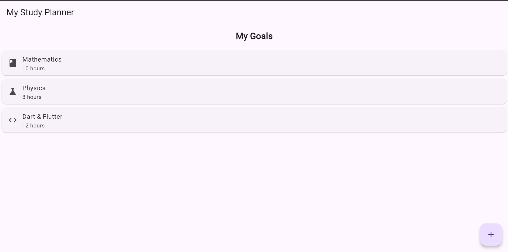
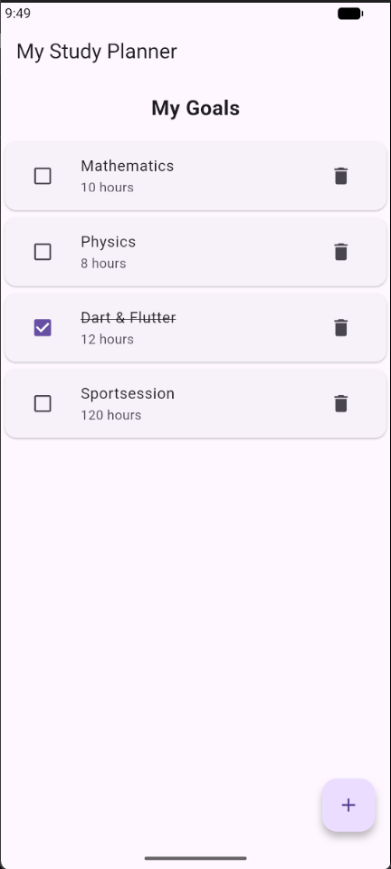
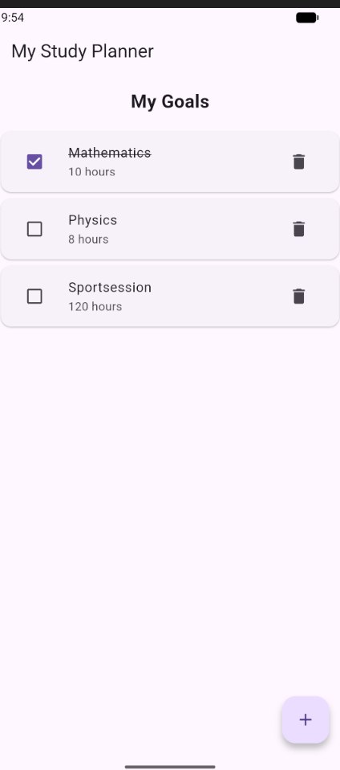

# study_planner

## Group 4 Members

| Registration Number |
|---|
| 27047/2024 |
| 25740/2024 |
| 25605/2024 |
| 26034/2024 |
| 26857/2024 |

## Project Phases

| Phase | Title | Status | Description |
|---|---|---|---|
| 1 | Static Screen | Done | The main screen with an AppBar, a heading, and three fixed goal cards. |
| 2 | Working List | Done | Goals are stored in a list. The user can mark a goal as done, delete a goal, and add a sample goal. Uses `StatefulWidget` and `setState`. |
| 3 | Statistics and Cards | Done | A summary row shows total hours, completed goals, and remaining goals, using `fold()` and `where()`. A reusable `StatCard` widget is used three times. |
| 4 | Second Screen | Pending | Add a form to create new goals, with validation, and navigate to it with `Navigator`. |
| 5 | Database | Pending | Save goals with SQLite (`sqflite`) so they stay after the app restarts. |

## Screenshots

### Phase 1: Static Screen

### Phase 2: Before toggle

### Phase 2: After toggle
